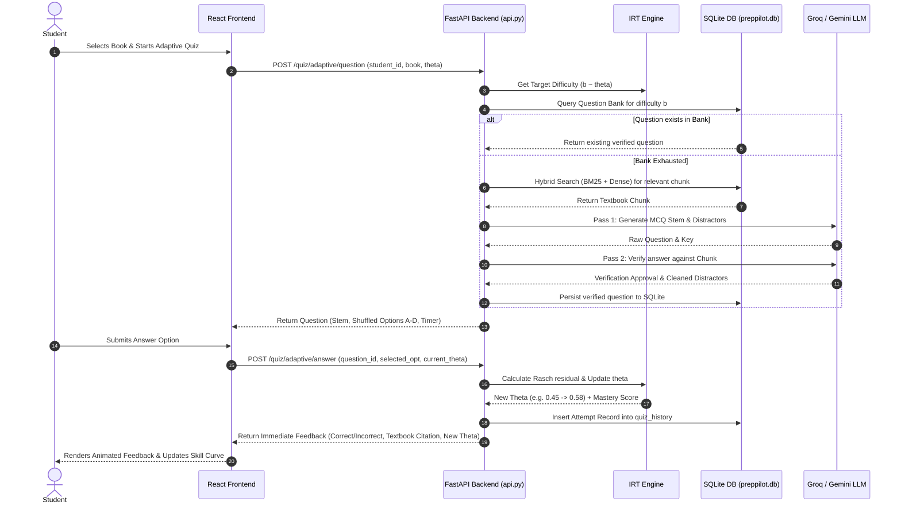

# PrepPilot: Autonomous RAG-Powered Adaptive Learning & Examination System
## Comprehensive Technical Documentation & Architecture Specification

---

## 1. Executive Summary & Project Overview

**PrepPilot** is an autonomous, hallucination-resistant academic study and assessment engine designed to transform massive, dense undergraduate computer science textbooks into an interactive, personalized learning companion. 

Rather than treating generative AI as an unconstrained chat interface, PrepPilot anchors all reasoning, question generation, and answers in **12,864 indexed textbook chunks** extracted from four foundational curriculum textbooks:
1. **Introduction to Algorithms (CLRS)** — 35 indexed chapters (Algorithms & Complexity)
2. **Data Structures & Algorithms** — 16 indexed chapters (Trees, Graphs, Memory Structures)
3. **Let Us C (Yashavant Kanetkar)** — 23 indexed chapters (C Language Foundations & Pointers)
4. **C++: The Complete Reference (Herbert Schildt)** — 38 indexed chapters (OOP, Templates, Memory Management)

### Team Roles & Contribution Breakdown
- **Simar (Backend Lead — Intelligent Engines & Psychometrics)**:
  - Directed Acyclic Graph (DAG) Prerequisite Engine, cycle detection, and topological learning sequence generation.
  - Item Response Theory (1-PL IRT / Rasch Model) adaptive testing algorithm and real-time $\theta$ (theta) ability estimation.
  - Mock Examination Hall (T1, T2, T3) with syllabus partitioning and diagnostic prerequisite error mapping.
  - Spaced Repetition (SM-2) scheduling and database persistence architecture.
- **Aditya (Backend Lead — Core RAG & Database Architecture)**:
  - Document ingestion and PyMuPDF structural chunking pipeline across 12,864 passages.
  - Hybrid Search implementation (Dense `all-MiniLM-L6-v2` embeddings + SQLite FTS5 BM25 with Reciprocal Rank Fusion $k=60$).
  - Two-pass LLM fact verification and distractor bias-elimination pipelines.
  - FastAPI REST service layer and SQLite WAL mode optimization.
- **Pranvi (Frontend Lead — UX Architecture & Design System)**:
  - Complete React 18 + Vite SPA architecture and state management.
  - Luxury theme system: 6 palettes (Obsidian Gold, Royal Navy, Titanium Jade in both Dark & Light modes).
  - Floating island navigation with collapsible sidebar and zero layout shift.
  - Interactive exam hall palette, timer synchronization, and real-time score analytics.

---

## 2. Problems Faced Before & Engineering Solutions

Traditional AI study tools and generic RAG prototypes suffer from severe architectural limitations when applied to engineering curricula. Below are the specific problems identified in early prototypes and the engineering solutions implemented in PrepPilot:

| # | Naive / Legacy Approach | Limitation & Failure Mode | PrepPilot Engineering Solution |
|---|---|---|---|
| **1** | **Pure Dense Vector Search (FAISS/Embeddings alone)** | Dense embeddings map semantics well but fail on exact syntax (`realloc()`, `char *p[]`), code snippets, Big-O complexities ($O(V + E)$), and case identifiers ("Red-Black Tree Case 3"). FAISS in-memory indices also required separate serialization and lacked relational metadata integrity. | **Hybrid Search via SQLite FTS5 + Dense Vectors**: Unified in a single SQLite database with ACID compliance, combining semantic understanding with exact lexical keyword matching via Reciprocal Rank Fusion ($k=60$). |
| **2** | **Pure Lexical Search (BM25 alone)** | Brittle against vocabulary mismatch. If a student asks *"How does quicksort pick its pivot?"* but the textbook states *"Subroutine partition selects the initial comparison element"*, BM25 misses the passage. | **Reciprocal Rank Fusion (RRF)**: Merges the top ranks of dense semantic search and sparse BM25 search without score calibration issues. |
| **3** | **Unconstrained LLM Question Generation** | Standard LLMs hallucinate plausible-looking but non-existent algorithms, create incorrect answer keys, and exhibit heavy distractor bias (statistically placing correct answers under option 'C' or 'B'). | **Two-Pass Adversarial Fact Verification**: Pass 1 generates questions from a textbook chunk; Pass 2 acts as a strict auditor checking whether the chunk unequivocally supports the answer. Distractors are systematically randomized. |
| **4** | **Static One-Size-Fits-All Quizzes** | Students are presented fixed-difficulty questions. Beginners face complex questions and get discouraged; advanced students receive basic questions with zero diagnostic value. Classical percentage scores do not reflect true latent ability. | **1-Parameter Logistic Item Response Theory (1-PL IRT / Rasch Model)**: Dynamic difficulty adjustment matching question difficulty ($b$) to student latent ability ($\theta$), maximizing Fisher Information. |
| **5** | **Linear, Out-of-Order Studying** | Students attempt advanced topics (e.g., Dynamic Programming, Dijkstra's algorithm) without foundational mastery (Recursion, Heaps, Graph Adjacency Lists), causing high failure rates without understanding root causes. | **Prerequisite Graph Engine (DAG)**: Models chapters as a directed acyclic graph. When a student misses a mock exam question, the engine diagnoses the root cause by mapping back to unmastered foundational prerequisite chapters. |
| **6** | **Disorganized Exam Preparation** | Students do not study according to university exam patterns (Midterm 1, Midterm 2, Comprehensive End-Term). | **Syllabus Intelligence Engine**: Automatically partitions courses into 33.3% increments (T1, T2, T3) with manual override capabilities and exam-specific mock testing. |

---

## 3. Deep Dive: Why Hybrid Search? (Mathematical Formulation)

A central innovation in PrepPilot's backend is the rejection of pure vector databases in favor of a hybrid retrieval engine combining **Dense Vector Search** and **Sparse Lexical Search (BM25)** inside SQLite.

```
                     +---------------------------------------+
                     |           Student Query / Ask         |
                     +-------------------+-------------------+
                                         |
                     +-------------------+-------------------+
                     |                                       |
                     v                                       v
         +-----------------------+               +-----------------------+
         | Dense Embedding Model |               |   SQLite FTS5 Token   |
         | (all-MiniLM-L6-v2)    |               |   BM25 Lexical Parser |
         +-----------+-----------+               +-----------+-----------+
                     | 384-dim vector                        | Query string
                     v                                       v
         +-----------------------+               +-----------------------+
         | Cosine Distance Scan  |               | SQLite FTS5 Match     |
         | Rank List: R_vector   |               | Rank List: R_bm25     |
         +-----------+-----------+               +-----------+-----------+
                     |                                       |
                     +-------------------+-------------------+
                                         |
                                         v
                     +---------------------------------------+
                     |       Reciprocal Rank Fusion          |
                     |  RRF(d) = sum( 1 / (60 + r_m(d)) )    |
                     +-------------------+-------------------+
                                         | Top-K Relevant Chunks
                                         v
                     +---------------------------------------+
                     |   Augmented Grounding Context to LLM  |
                     +---------------------------------------+
```

### Why Pure Vectors Fail in Technical Domains
Dense embeddings compress sentences into high-dimensional geometric spaces (384 float32 numbers). While exceptional for conceptual queries like *"What is the purpose of asymptotic analysis?"*, they suffer from severe signal degradation on technical specifics:
- Searching for `O(V \log V + E)` in a vector database frequently returns passages describing `O(V^2)` or general graph definitions because the semantic distance between Big-O expressions is tiny.
- C programming tokens such as `int (*func)(void *)` or `malloc()` lose their exact character signature during tokenization and pooling.

### Why BM25 Alone Fails
Lexical BM25 measures term frequency and inverse document frequency:
$$\text{BM25}(D, Q) = \sum_{i=1}^{N} \text{IDF}(q_i) \cdot \frac{f(q_i, D) \cdot (k_1 + 1)}{f(q_i, D) + k_1 \cdot \left(1 - b + b \cdot \frac{|D|}{\text{avgdl}}\right)}$$
If a student phrases a question using synonyms or conceptual terms not verbatim in the textbook (e.g., *"How do I release dynamically allocated heap blocks?"* vs *"freeing allocated memory with free"*), BM25 fails completely.

### The Hybrid Solution: Reciprocal Rank Fusion (RRF)
To combine dense semantic search and sparse lexical search without the fragility of score normalization, PrepPilot implements **Reciprocal Rank Fusion (RRF)**:

$$\text{RRF\_Score}(d \in D) = \sum_{m \in \{\text{Dense}, \text{BM25}\}} \frac{1}{k + r_m(d)}$$

Where:
- $D$ is the set of all retrieved candidate chunks.
- $m$ represents the retrieval model ($\text{Dense}$ or $\text{BM25}$).
- $r_m(d)$ is the 1-based rank index of chunk $d$ in the result set of model $m$.
- $k = 60$ is the standard smoothing constant (proven by Cormack et al. to prevent high-ranking outliers from dominating the fused score).

**Key Architectural Benefits:**
1. **Scale Invariance**: Cosine similarities range between $[-1, 1]$ while BM25 scores range from $[0, +\infty)$. Standard linear combination ($\alpha S_{dense} + (1-\alpha) S_{bm25}$) requires fragile heuristic tuning. RRF uses purely ordinal ranks, making it completely robust.
2. **Mutual Reinforcement**: If a document appears in the top 5 of *both* dense and BM25 searches, its RRF score surges to the top. If it only appears in one, it is gracefully retained without displacing universally agreed-upon results.

---

## 4. Models & AI Infrastructure

PrepPilot utilizes a tiered model architecture prioritizing local performance, high inference speed, and cost efficiency:

### 1. Embedding Model: `sentence-transformers/all-MiniLM-L6-v2`
- **Dimensions**: 384 dimensions.
- **Model Size**: ~80 MB (22.7 Million parameters).
- **Inference Speed**: ~8ms per query on CPU, sub-millisecond on modern GPUs.
- **Role**: Computes dense vector embeddings for textbook chunks during ingestion and converts student queries into query vectors in real time.

### 2. High-Speed Cloud Reasoning: Groq API
- **Primary LLM**: `openai/gpt-oss-120b` & `llama3.1:8b` via Groq's LPU (Language Processing Unit).
- **Latency**: 300–800 tokens per second, yielding near-instantaneous question generation and answers (<1.5s total turnaround time).
- **Role**: Complex textbook synthesis, multi-step code explanation, and rigorous fact-verification auditor.

### 3. Graceful Cloud Fallback: Google Gemini 2.5 Flash
- Integrated as an automated failover client. If the primary cloud endpoint encounters rate limiting or latency spikes, PrepPilot automatically routes requests to Gemini 2.5 Flash without interrupting the student's session.

### 4. Local Privacy / Offline Mode: Ollama (`qwen2.5:7b` / `llama3.1:8b`)
- Compatible with local endpoints (`http://localhost:11434/v1`).
- Allows universities and students with privacy constraints or offline requirements (e.g. running on an NVIDIA RTX 3070 8GB VRAM) to run 100% locally without external API dependencies.

---

## 5. Module-by-Module Technical Breakdown

### Module 1: Document Ingestion & Chunking Pipeline
- **Extractor**: PyMuPDF (`fitz`) parses structured PDF documents, retaining chapter numbers, section headings, and physical page numbers.
- **Chunking Strategy**: Boundary-aware semantic chunking (~500 tokens per chunk with 50-token rolling window overlap). Chunks do not arbitrarily bisect paragraphs or code routines.
- **Metadata Tagging**: Each chunk is indexed with `(book_id, chapter, chapter_title, section, page_start, page_end)`.
- **Database Architecture**: SQLite with Write-Ahead Logging (`WAL` mode) for concurrent reads/writes without lock contention.
  - Table `chunks`: Stores chunk text, metadata, and binary 384-float vector BLOBs.
  - Virtual Table `chunks_fts`: FTS5 full-text index tokenized using the Porter stemming tokenizer.

### Module 2: Strict Citation RAG Q&A Engine
- **Grounding Policy**: The system prompt enforces strict evidence attribution:
  > *"You are PrepPilot's Academic Assistant. Answer using ONLY the provided textbook excerpts. If the excerpts do not contain the answer, state explicitly that the indexed textbooks do not cover this topic. Every claim must cite [Book, Chapter, Page]."*
- **Output**: Returns the markdown response alongside structured citation chips that link directly to textbook chapters and physical page numbers.

### Module 3: Automated Verified Question Generator (Two-Pass Verification)
Generating reliable academic multiple-choice questions from textbooks requires eliminating hallucinated answers:
1. **Pass 1 (Generation)**: The LLM receives an indexed chunk and extracts an essential computer science concept, generating:
   - Question stem
   - 1 correct option
   - 3 plausible, conceptually relevant distractors
   - In-depth explanation
2. **Pass 2 (Verification & Audit)**: A second prompt evaluates the question against the raw textbook chunk:
   - *Is the correct answer explicitly supported by the text?*
   - *Are any distractors unintentionally valid or ambiguous?*
   - If verification fails, the question is discarded.
3. **Distractor Shuffling**: The options are randomized across keys (A, B, C, D) using a seeded Mersenne Twister RNG to prevent positional distractor bias.

### Module 4: Prerequisite Engine (DAG & Topological Sequencing)
Curriculum concepts have strict hierarchical dependencies.
- **Graph Representation**: Directed Acyclic Graph $G = (V, E)$, where vertex $u \in V$ is a prerequisite for vertex $v \in V$ if $(u, v) \in E$.
  - *Example*: Recursion (Ch 4) $\rightarrow$ Merge Sort (Ch 2) $\rightarrow$ Quick Sort (Ch 7); Binary Trees (Ch 12) $\rightarrow$ Red-Black Trees (Ch 13) $\rightarrow$ B-Trees (Ch 18).
- **Cycle Detection**: Implements Depth-First Search (DFS) with three-color node marking (White = unvisited, Gray = visiting, Black = fully visited). If a back-edge to a Gray node is encountered, a cycle is flagged and rejected.
- **Topological Sorting**: Uses Kahn's Algorithm / Reverse Post-Order DFS to output a valid linear learning sequence guaranteeing that a student never learns a concept before its dependencies.
- **Mastery Propagation**: A chapter's state is computed dynamically:
  - **Locked**: One or more prerequisites have accuracy $< 60\%$.
  - **Available**: All prerequisites mastered ($\ge 70\%$).
  - **Mastered**: Chapter's own accuracy $\ge 80\%$.

### Module 5: Adaptive Quiz Engine (1-PL IRT / Rasch Model)
Rather than static scoring, PrepPilot measures latent student ability on an unbounded continuous logit scale ($-\infty < \theta < +\infty$, normalized in UI to $[0.0, 1.0]$).

#### The Rasch Model Mathematical Formula
The probability that a student with latent ability $\theta$ correctly answers a question with difficulty $b_i$ is modeled by the logistic function:

$$P(X_i = 1 \mid \theta, b_i) = \frac{e^{\theta - b_i}}{1 + e^{\theta - b_i}} = \frac{1}{1 + e^{-(\theta - b_i)}}$$

Where:
- $\theta \in \mathbb{R}$ represents the student's current proficiency estimate.
- $b_i \in \mathbb{R}$ represents the question's calibrated difficulty ($b_{easy} = 0.25$, $b_{medium} = 0.50$, $b_{hard} = 0.85$).

#### Real-Time Bayesian Ability Update
After each response $X_i \in \{0, 1\}$, the system updates the student's ability estimate:

$$\theta_{t+1} = \theta_t + K \cdot \left(X_i - P(X_i = 1 \mid \theta_t, b_i)\right)$$

Where:
- $K = 0.4$ is the convergence step parameter.
- If a student answers a difficult question correctly ($X_i = 1, P \approx 0.2$), the residual $(1 - 0.2) = 0.8$ produces a substantial upward revision of $\theta$.
- If a student misses an easy question ($X_i = 0, P \approx 0.85$), the residual $(0 - 0.85) = -0.85$ sharply decreases $\theta$.

#### Maximum Fisher Information Question Selection
To achieve minimal measurement error, the next question is chosen to maximize Fisher Information:
$$I_i(\theta) = P_i(\theta) \cdot (1 - P_i(\theta))$$
This function peaks when $\theta = b_i$ ($P = 0.5$). The engine selects questions closest to the student's current skill frontier, guaranteeing maximum learning efficiency.

### Module 6: Full Mock Examination System (T1 / T2 / T3)
Simulates authentic university examination constraints:
- **T1 (Midterm 1)**: Covers initial foundational 33.3% of the syllabus (25 Questions, 30 Minutes).
- **T2 (Midterm 2)**: Covers intermediate 33.3% of the syllabus (25 Questions, 30 Minutes).
- **T3 (Comprehensive End-Term)**: Covers the entire curriculum (30% T1 + 30% T2 + 40% T3, 50 Questions, 60 Minutes).
- **Features**: Real-time decrementing countdown timer, persistent question palette (Answered, Unanswered, Marked for Review), and instant post-exam tier breakdown.
- **Diagnostic Prerequisite Error Mapping**: If a student fails questions in T3 covering *Minimum Spanning Trees*, the engine traces back through the DAG to identify that the student failed the prerequisite question on *Disjoint Set Union (Ch 21)*, recommending targeted revision.

### Module 7: Syllabus Intelligence Engine
- Automatically computes equal 33.33% textbook partitions based on chapter count and content chunk density.
- Allows students or instructors to drag-and-drop or select manual overrides (e.g. moving Chapter 7 into Test 1).
- Provides instant visibility into syllabus completeness and exam readiness.

### Module 8: Spaced Repetition Flashcards (SuperMemo SM-2)
- Automatically synthesizes active-recall flashcard pairs (Definition, Formula, Time Complexity) from textbook chunks.
- Implements the SM-2 spaced repetition scheduling algorithm:
  $$I(1) = 1 \text{ day}, \quad I(2) = 6 \text{ days}, \quad I(n) = I(n-1) \times EF$$
  $$EF' = EF + (0.1 - (5 - q) \times (0.08 + (5 - q) \times 0.02))$$
  Where $EF$ is the Easiness Factor and $q$ is the student's self-assessed grade.

### Module 9: Frontend Design System & Theme Engine
- **Floating Island Navigation**: Replaces full-height sidebars with a floating, collapsible navigation panel with zero scrollbar leakage and responsive mobile support.
- **6 Custom Academic Themes**:
  - *Obsidian Gold* (Dark): `#171717` background with `#B08D57` champagne gold accents.
  - *Champagne Cream* (Light): `#F8F5EF` paper background with high-contrast `#252525` typography.
  - *Royal Navy* (Dark): `#101B30` deep navy with `#B89555` antique gold accents.
  - *Academic Ivory* (Light): `#F7F5F0` warm ivory with `#101B30` navy typography.
  - *Titanium Jade* (Dark): `#172421` deep spruce with `#438B78` emerald accents.
  - *Titanium Mint* (Light): `#F3F5F4` spruce light with dark forest `#172421` typography.
- **Universal Variable Propagation**: Zero hardcoded hex colors inside component views; all cards, pills, buttons, and text dynamically inherit theme tokens.

---

## 6. End-to-End System Workflow

### Lifecycle of an Adaptive Quiz Request



---

## 7. Presentation & Viva Defense Guide

### Anticipated Questions & Bulletproof Answers

#### Q1: "Why did you build a custom Hybrid Search instead of just using Pinecone, ChromaDB, or FAISS?"
> **Answer**: *"Standard vector databases like Pinecone or FAISS only index dense semantic vectors. In computer science education, queries often contain exact programming syntax, code snippets, function names like `realloc()`, and exact asymptotic complexities like $O(V + E)$. Dense vectors frequently confuse $O(V + E)$ with $O(V^2)$ because their linguistic contexts are similar. By deploying a hybrid retrieval system within SQLite combining FTS5 (BM25 lexical matching) and 384-dimensional dense vectors via Reciprocal Rank Fusion ($k=60$), we achieve the best of both worlds: semantic understanding of intent and exact syntactic precision, all with zero external cloud database overhead and full ACID transactional consistency."*

#### Q2: "How do you guarantee that your question generator doesn't hallucinate wrong answers?"
> **Answer**: *"We implemented a Two-Pass Adversarial Fact-Verification pipeline. In Pass 1, the LLM extracts key pedagogical concepts from a specific textbook chunk and generates an MCQ. In Pass 2, a separate verification prompt evaluates the generated question against the raw textbook text to confirm that the text strictly substantiates the correct answer and that no distractors are ambiguous. If Pass 2 fails, the question is discarded. Furthermore, every question displays its origin citation (Book, Chapter, Page Number), so students can verify claims directly against their physical textbook."*

#### Q3: "What is the mathematical justification for using Item Response Theory (IRT) over classical test percentages?"
> **Answer**: *"Classical test theory calculates score simply as $Score = \frac{Correct}{Total}$. This metric is flawed because answering 8 easy questions correctly yields the same 80% score as answering 8 extremely difficult questions. Item Response Theory (specifically the 1-Parameter Logistic Rasch Model) models student performance probabilistically:
> $$P(X=1 \mid \theta, b) = \frac{1}{1 + e^{-(\theta - b)}}$$
> It separates student ability ($\theta$) from question difficulty ($b$). Our engine dynamically updates $\theta$ in real time and chooses questions that maximize Fisher Information ($b \approx \theta$), ensuring the test is neither frustratingly difficult nor trivially easy, while objectively reflecting true latent mastery."*

#### Q4: "How does the Prerequisite Engine handle cyclic dependencies?"
> **Answer**: *"We model curriculum topics as a Directed Acyclic Graph (DAG). During graph initialization, the engine executes a three-color Depth-First Search cycle detection algorithm (White = unvisited, Gray = visiting, Black = visited). If an edge targets a Gray node, a cyclic dependency is flagged and rejected. When a student takes a Mock Exam and fails an advanced question, the DAG allows the engine to backtrack to foundational prerequisites and diagnose precisely where the student's conceptual gap originated."*

#### Q5: "What role did each team member play in the development of PrepPilot?"
> **Answer**:
> - **Pranvi** designed and developed the entire frontend user experience: the React 18 SPA, floating navigation, the 6 luxury academic themes, responsive exam hall timer, and interactive data visualization.
> - **Aditya** architected the core RAG ingestion and retrieval backend: the PyMuPDF document parser, chunking across 12,864 passages, SQLite FTS5 + MiniLM hybrid search, and two-pass LLM fact-verification.
> - **Simar** engineered the intelligence algorithms and assessment engines: the DAG prerequisite graph with cycle detection, the 1-PL IRT adaptive testing engine, the full T1/T2/T3 Mock Exam simulator with root-cause diagnostic backtracking, and the SuperMemo SM-2 spaced repetition scheduler.

---

## 8. Summary Checklist for Presentation Day

1. **Backend Server**: Ensure FastAPI is running on `http://127.0.0.1:8000` via `python -m uvicorn api:app --reload`.
2. **Frontend App**: Ensure Vite dev server is running on `http://localhost:5173`.
3. **Database**: Confirm `preppilot.db` is present in the workspace root with 12,864 chunks indexed.
4. **Key Demo Flow to Show Professors**:
   - **Step 1**: Show Workspace Overview with live metrics (12,864 chunks, streak, accuracy).
   - **Step 2**: Demonstrate **AI Study Assistant** with a technical question (e.g., *"Explain Red-Black Tree rotation cases"*) $\rightarrow$ Highlight strict `[CLRS Ch. 13 Page 312]` citations.
   - **Step 3**: Demonstrate **Adaptive Quiz** $\rightarrow$ Answer an easy question correctly $\rightarrow$ Show real-time ability $\theta$ rising and the next question being harder.
   - **Step 4**: Demonstrate **Prerequisite Engine** $\rightarrow$ Show the visual DAG dependency map and how unlocking foundational chapters unlocks advanced topics.
   - **Step 5**: Demonstrate **Mock Exams** $\rightarrow$ Show T1 (33%), T2 (33%), T3 (100%) exam modes, countdown timer, question palette, and diagnostic prerequisite review.
   - **Step 6**: Toggle through Themes (Light mode & Dark mode) $\rightarrow$ Show clean contrast and floating navigation.
